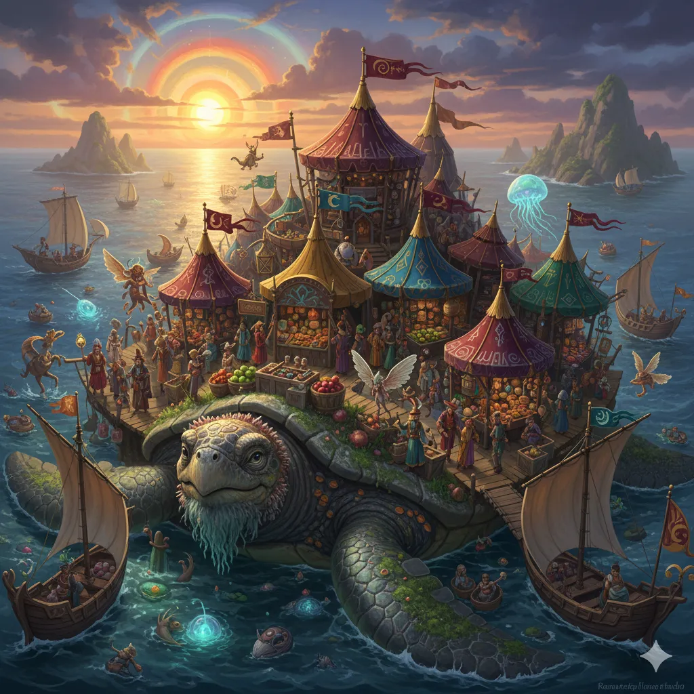

_Ruchomy kram międzywymiarowego kupca, rozłożony na grzbiecie [[Wielki Żółw|Wielkiego Żółwia]]._

Bazar [[Shazum|Shazuma]] rozłożony jest na grzbiecie żółwia.

Z pokładu statku wygląda jak niezaznaczona na mapach wysepka. Shazum przedstawił się jako podróżnik między światami, oferujący cuda z najdalszych zakątków multiwersum.

## Ciekawe Miejsca
- **Kram z miksturami**: Mikstury lecznicze, którymi zaopatrzyła się drużyna.
- **Stoisko z osobliwościami**: Unikatowe przedmioty magiczne; drużyna kupiła tu jeden z nich.

## Mieszkańcy
[[Shazum]] — ekscentryczny, lewitujący kupiec podróżujący między światami. Wśród klientów bywają marynarze z [[Arezja|Arezji]].

## Historia
W [[Sesja 61 - Yala, Arezja i Żółw]] bohaterowie natrafili na bazar na pełnym morzu. Uzupełnili mikstury lecznicze i kupili unikatowy przedmiot magiczny. [[Shazum]] wspomniał, że bywał w [[Eberron|Eberronie]], rodzinnym świecie [[Arevon Elorrenthi|Arevona]], choć nie przypadł mu on do gustu. Od handlujących obok marynarzy drużyna dowiedziała się o [[Królowa Helena|Królowej Helenie]].

W [[Sesja 62 - Arezyjska Dyplomacja]] podsumowanie zaczyna się od tej samej wizyty na bazarze: bohaterowie zbierali informacje od marynarzy z Arezji przed przybyciem do [[Arezja|Arezji]]. Dowiedzieli się, że Królowa Helena gardzi kłamstwem i pochlebstwami, a aby zyskać jej przychylność, trzeba przekonać Radę Pięciu Mistrzów i boga [[Narsus|Narsusa]].
