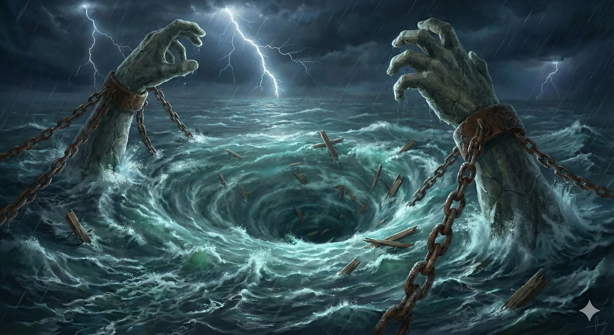

_Gigantyczny wir wodny na krańcu znanego świata, stanowiący śmiertelne zagrożenie oraz przejście do Morza Otchłani._

## Opis
Charybda to potężny, nieskończony wir morski na krańcu znanego świata, tworzony przez gigantyczne, kamienne dłonie wyłaniające się z oceanu, które metodycznie mieszają wodę. Wir jest bramą prowadzącą do [[Morze Otchłani|Morza Otchłani]]: wpłynięcie w jego środek jest aktem szaleństwa — prawa fizyki przestają obowiązywać, a góra staje się dołem.

Początkowo wydawała się jedynie zagrożeniem nawigacyjnym.<!-- UNSOURCED -->

Kamienne dłonie to prawdopodobnie dłonie [[Kentimane]] lub jego manifestacje.<!-- UNSOURCED -->

## Historia
W [[Sesja 18 - Cienie Mytros]] [[Arevon Elorrenthi|Arevon]] usłyszał na Rybim Targu o statku z [[Arezja|Arezji]], pełnym młodych mnichów wojowników, który został wciągnięty przez wir Charybda w drodze na [[Wyspa Skorpiona|Wyspę Skorpionów]].

W [[Sesja 31 - Wyprawa na Themis]] drużyna napotkała Charybdę podczas rejsu na [[Themis]]. Statek został wciągnięty w wir, z którego wyłonił się tytan [[Kentimane]], uwalniając bohaterów z pułapki.

W [[Sesja 64 - Pieśń dla Smoczycy]] drużyna obrała kurs na Charybdę po zdobyciu [[Zguba Tytanów|Zguby Tytanów]], gotowa na zejście do Otchłani.

W [[Sesja 65 - Wyprawa w Otchłań]] załoga [[Ultros|Ultrosa]] dotarła do krańca znanego świata i ujrzała kamienne dłonie mieszające wodę w nieskończonym wirze. Kapitan z nawigatorem skierowali statek w sam środek chaosu; okręt runął w przepaść, świat zawirował, a po odzyskaniu zmysłów bohaterowie znaleźli się na czarnych wodach Morza Otchłani.

W [[Sesja 70 - Audiencja u Pani Snów]] drużyna opuściła okolice Charybdy w drodze do [[Praxys]]; na drugi dzień po jej opuszczeniu na horyzoncie pojawił się [[Keledone|Keledon]] niosący [[Volkan]]a z darami.
