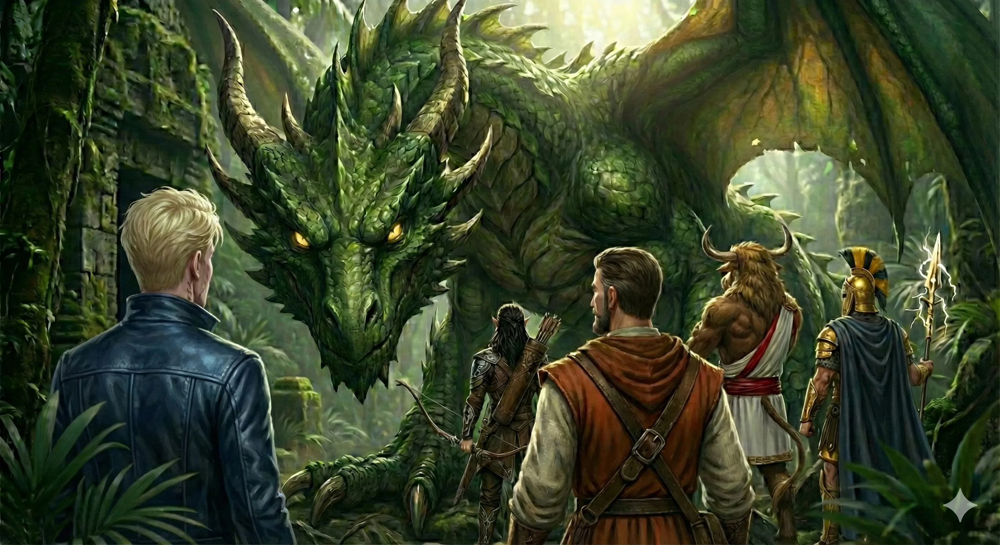

_Wyspa o kształcie śpiącego gada, porośnięta gęstą, duszną dżunglą, będąca domeną Starożytnej Zielonej Smoczycy [[Hexia|Hexii]]._

## Opis
Wyspa ma kształt przypominający śpiącego gada i porasta ją gęsta, duszna dżungla. Wokół wyspy czai się [[Kraken]], którego ofiary są wyrzucane na brzeg po sztormach. Na plaży wystaje z wody samotna skała z wyrytym symbolem Krakena, identycznym z tym z amuletu na [[Wyspa Forlorn|Wyspie Chimery]].

Wyspa Smoka leży na Zapomnianym Morzu. Jej wybrzeża są usiane licznymi zatoczkami i piaszczystymi plażami, dogodnymi do lądowania. Dżungla jest nienaturalnie gęsta i splątana, co jest efektem wpływu Hexii. Flora jest bujna, ale złowroga.

Po wojnie wciąż mieszka tu [[Hexia]].

## Ciekawe Miejsca
-   **Leże Hexii**: Polana w centrum wyspy, ze skarbcem smoczycy i krystalicznie czystym jeziorem zasilanym wodospadem; drzewa wokół „udekorowano" kośćmi ofiar.  
    Polana leży w głębi dżungli, a drzewa wokół wydają się nienaturalnie ożywione.
-   **Dżungla**: Dom dla dzikich zwierząt i dwóch grup elfów.
-   **Skała Krakena**: Wystająca z wody skała z symbolem Krakena, będąca zwiastunem zagrożenia z głębin.

## Mieszkańcy
-   **[[Hexia]]**: Starożytna Zielona Smoczyca, władczyni wyspy.
-   **Krąg Łuski**: Fanatyczni druidzi oddani Hexii, służący jej jako szpiedzy i słudzy.
-   **Elficki Ruch Oporu** (dawniej): Pod wodzą [[Darok|Daroka]] i [[Patrea|Patrei]]. Dzicy buntownicy ukrywający się w dżungli; po [[Sesja 64 - Pieśń dla Smoczycy]] piętnastu elfich wojowników opuściło wyspę na pokładzie Ultrosa.

## Historia
Wyspa od wieków jest domeną Hexii. Smoczyca sprowadziła tu lub uwięziła setki elfów, polując na nie dla sportu i przyjemności.

W [[Sesja 21 - Ukryte pragnienia Ismene]] [[Varkon]] zgodził się zabrać drużynę na Smoczą Wyspę za 20 tysięcy sztuk złota. W [[Sesja 54 - Wyznanie Chondrusa]] nowe konstelacje wskazały wyspę jako legowisko Hexii i cel wyprawy.

W [[Sesja 64 - Pieśń dla Smoczycy]] na wyspę przybyli Bohaterowie Przepowiedni, a na plaży dołączyła do nich [[Moxena]] ze statkiem w barwach [[Themis]]. Drużyna spotkała ruch oporu pod wodzą Daroka i Patrei oraz druidów Kręgu Łuski. Dzięki Pieśni Ochosa w wykonaniu [[Orestes|Orestesa]] zdołali przebłagać smoczycę. Hexia oddała im miecz [[Zguba Tytanów]] w zamian za przysięgę zwrotu broni oraz swoją więźniarkę [[Ophea|Opheę]], matkę Oriona. Piętnastu elfich wojowników z ruchu oporu przyjęło propozycję opuszczenia wyspy i dołączyło do załogi Ultrosa.

W [[Sesja 84 - Świt Nowej Ery]] [[Versir]] poleciał na wyspę oddać Hexii jej miecz, a smoczyca była lekko pozytywnie zaskoczona, że dotrzymał słowa.
