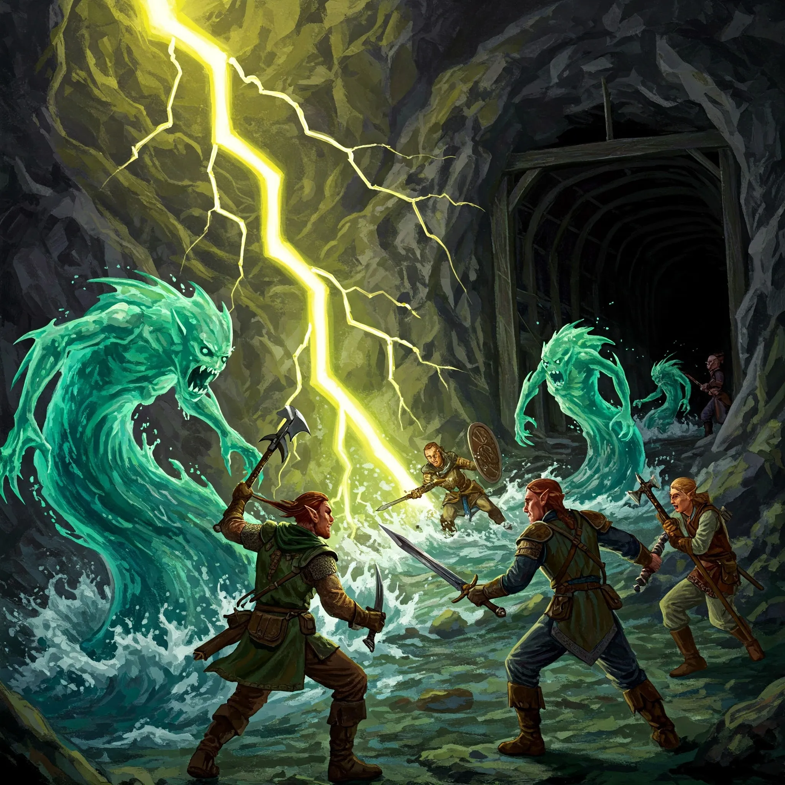

_Jedyna kopalnia żelaza w Thylei, znajdująca się w górach w głębi Wyspy Indygo i strzeżona przez Plemię Wieloryba._

## Opis
Kopalnia Żelaza to rozległy kompleks tuneli wydrążonych w górach [[Wyspa Indygo|Wyspy Indygo]]. Jest to miejsce o strategicznym znaczeniu, będące jedynym znanym źródłem żelaza w całej krainie. Na koniec kampanii wciąż pozostaje pod strażą krasnoludzkiego [[Plemię Wieloryba|Plemienia Wieloryba]].

## Mieszkańcy
Kopalnia jest domem i miejscem pracy dla [[Plemię Wieloryba|Plemienia Wieloryba]] (krasnoludów).

## Historia
Przez długi czas krasnoludy wydobywały tu żelazo w spokoju.

W [[Sesja 43 - Kopalnia Żelaza]] kopalnię zajęła miedziana smoczyca [[Ventis]], która uczyniła z niej swoje leże. Wejścia strzegła armia wiewiórek i krab uzbrojony w sztylet, a wnętrza patrolowały wodne żywiołaki i żywe pioruny, z którymi starli się bohaterowie. Ventis przetrzymywała tu również [[Brenna|Brennę]], córkę wodza [[Delg|Delga]], zmuszając go tym do posłuszeństwa.

W [[Sesja 44 - Ventis]] drużyna zeszła drabiną do leża Ventis, uratowała Brennę i zabiła smoczycę. Kopalnia wróciła pod kontrolę Plemienia Wieloryba.

W [[Sesja 84 - Świt Nowej Ery]] krasnoludy z Plemienia Wieloryba wciąż trzymały straż nad kopalnią w górach w głębi wyspy.
