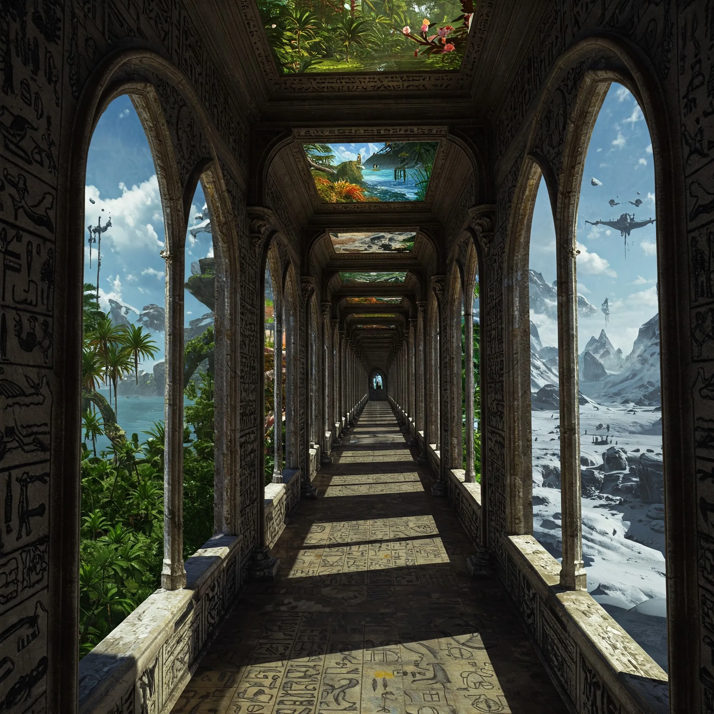

Magiczny korytarz znajdujący się w wieży [[Wiedźma Lotosu|Wiedźmy Lotosu]]. Jego ściany pokryte są hieroglifami, a liczne okna ukazują widoki z innych światów, czasów i planów egzystencji.

## Ciekawe Miejsca / Wizje
- **Elysium**: Siedziba Zeusa. <!-- UNSOURCED -->
- **Zatopione Królestwo Syren**: Zniszczone przez gniew Sydona.
- **Plan Astralny**: Miejsce podróży Kapitana Bomby. <!-- UNSOURCED -->
- **Śródziemie**: Bitwa o Helmowy Jar. <!-- UNSOURCED -->
- **Avernus**: Lewitujące miasto. <!-- UNSOURCED -->
- **Hades**: Charon pobierający opłaty.
- **Fabryka Warforgedów**: Eberron.
- **Płonące Mytros**: Apokaliptyczna wizja przyszłości z Behemotem.
- **Bryn Shander**: Icewind Dale.
- **Śpiący Tarrasque**.
- **Nowy Jork**: Avengersi.

## Historia
W [[Sesja 41 - Wiedźma Lotosu]] bohaterowie przemierzyli ten korytarz, doświadczając wizji, które rzuciły światło na ich przeszłość, przyszłość oraz naturę multiwersum. Po jego przejściu trafili na teleturniej Familiada prowadzony przez Karola Strasburgera.
