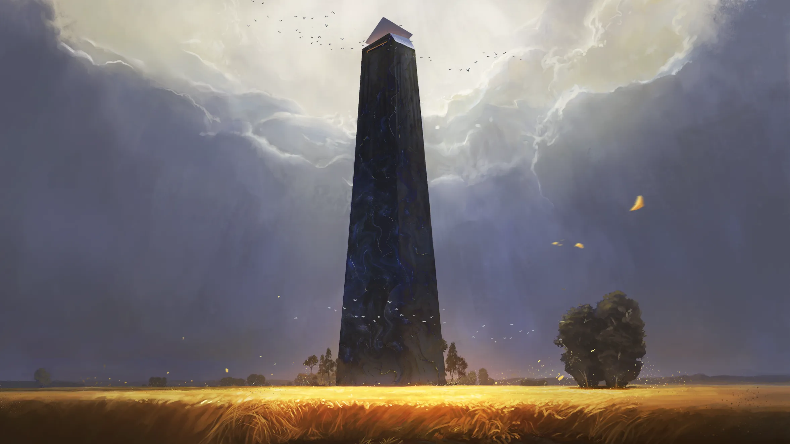

Wysoka wieża zamieszkana przez [[Wiedźma Lotosu|Wiedźmę Lotosu]], stojąca na [[Wyspa Skorpiona|Wyspie Skorpiona]].

## Ciekawe Miejsca
- **Pola Lotosu**: Rozległe pole kwiatów lotosu otaczające wieżę. Wokół wieży dzień i noc następują w zawrotnym tempie, a otoczenie jest rozmyte i nierealne.
- **Wnętrze Wieży**: Znajduje się tam statua sfinksa oraz dzieci produkujące narkotyki z lotosu. Wnętrze zamienia wchodzących w dzieci i więzi ich w pętli niekończących się schodów; po odzyskaniu postaci schody prowadzą do [[Korytarz Światów|Korytarza Światów]].

## Mieszkańcy
- [[Wiedźma Lotosu]]
- Dzieci

## Historia
Drzwi wieży otworzyły się przed bohaterami same.

W [[Sesja 40 - Uciechy na Wyspie Skorpiona]] bohaterowie dotarli do wieży, doświadczając zakrzywień czasu na polach lotosu.

W [[Sesja 41 - Wiedźma Lotosu]] bohaterowie zostali w jej wnętrzu zamienieni w dzieci i zmuszeni do pracy przy produkcji narkotyków z lotosu; schody okazały się magiczną pułapką. Odzyskawszy postać, dotarli schodami do Korytarza Światów.
