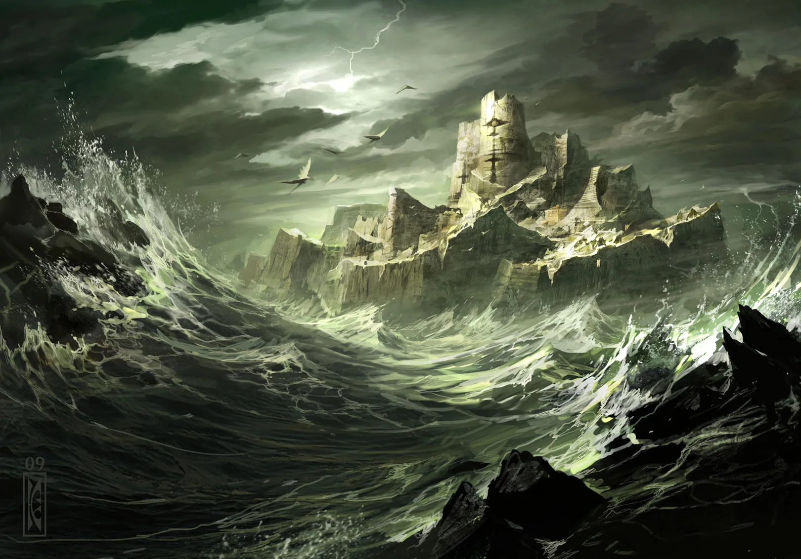

Ponura, skalista wyspa w [[Zatoka Cerulańska|Zatoce Cerulańskiej]], siedziba [[Mojry|Mojr]]. Nad krajobrazem dominują zrujnowane blanki prastarej wieży.

## Opis
Wyspa jest ponura i skalista, z poszarpanymi klifami i niewielką zatoczką. Tutejsze wody są skażone przez Morze Otchłani i nie wolno tam jeść ani pić.

Wyspa jest otoczona wiecznym deszczem i mgłą, a roślinność składa się głównie z mchów i skarłowaciałych drzew. <!-- UNSOURCED -->

Na wyspie stoją ruiny wieży gigantów, pod którą leżą kości gigantów; dalej znajduje się cuchnące jezioro z wejściami do jaskiń Mojr.

## Ciekawe Miejsca
- **Cuchnący Staw (Fetid Pond)**: Wypełniony żółtą posoką i larwami dusz. <!-- UNSOURCED --> Cuchnące jezioro z wejściami do jaskiń Mojr.
- **Siedziba Wiedźm (Lair of the Hags)**: Główna jaskinia, gdzie stoi Krosno Losu zrobione z kości smoka. <!-- UNSOURCED -->
- **Zrujnowana Wieża Gyganów**: Pozostałość po dawnym imperium; w jej ruinach znaleziono zwoje z kroniką wojny Smoczych Lordów z Imperium Gyganów.
- **Jaskinia Mantykor**: Legowisko bestii służących wiedźmom. <!-- UNSOURCED -->

## Mieszkańcy
- **[[Mojry]]**: [[Morta]], [[Nona]], [[Decima]].

## Historia
Dawniej zamieszkana przez Gyganów. Obecnie siedziba Mojr. <!-- UNSOURCED -->

Wyprawa statkiem na Wyspę Mojr śniła się [[Orestes|Orestesowi]] w [[Sesja 13 - Wezwani przez Króla]], a w [[Sesja 30 - Zakończenie Igrzysk]] znów śnił o niej w koszmarze razem z trzema postaciami.

Bohaterowie odwiedzili wyspę w [[Sesja 47 - Wyspa Mojr]], szukając sposobu na zdjęcie klątwy ze smoczych jaj. Stoczyli tu walkę z przerażającymi monstrami (Wielooka Matka, Bloodskitter Horror) i negocjowali z Mojrami. W [[Sesja 48 - Pakty z Mojrami i Zew Chimery]] negocjacje zakończyły się paktami: [[Felicjan Janus Twardowski|Felicjan]] oddał Mojrom połowę skuteczności leczenia, [[Arevon Elorrenthi|Arevon]] swoją szybkość, a [[Morta]] zdjęła klątwę, obracając artefakty w pył.
