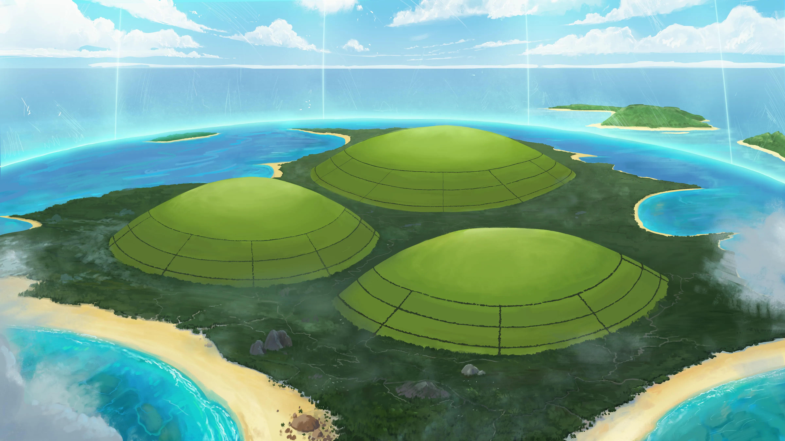

Dziwna wyspa z trzema niemal identycznymi zielonymi wzgórzami, otoczona przezroczystą sferą będącą dziełem Starej Magii, wyrastającą z Zatoki Cerulańskiej.

## Opis
Wyspa ma trzy idealnie równe wzgórza, bujną roślinność i drzewa uginające się pod ciężarem dziwnych owoców. Cała jest otoczona ogromną, przezroczystą sferą, która jest dziełem „Starej Magii"; według zaklęcia Identify teleportacja powinna pozwolić ją przekroczyć.

## Ciekawe Miejsca
- **Szklana Kopuła (Wall of Dreams)**: Niezniszczalna bariera. Każdy, kto ją zobaczy, ma dziwne sny o przedmiotach, których pragnie najbardziej. <!-- UNSOURCED --> Odbiła kruka Arevona i przyzwanego łososia.
- **Trzy Wzgórza**: Pokryte idealnie ułożonymi polami trzciny cukrowej. <!-- UNSOURCED -->
- **Jaskinie**: Pod dębami znajdują się wejścia do sieci jaskiń i tuneli. <!-- UNSOURCED -->

## Mieszkańcy
- **[[Myrmeki]]**: Żyją w jaskiniach, gdzie magazynują żywność i chronią swoją królową. <!-- UNSOURCED --> Mrówkopodobne istoty maszerują w równych szeregach i zbierają owoce; powtarzają gesty i słowa przybyszów.

## Historia
Wyspa została zapieczętowana przez Kentimane'a Tysiącrękiego pięć tysiącleci temu. Legendy sugerują, że pierwotna wojna między Tytanami była bezpośrednim wynikiem tego, co się tutaj wydarzyło. <!-- UNSOURCED -->

W [[Sesja 50 - Nawałnica Tytanów i Szepty Yonder]] bohaterowie dotarli do wyspy. Bariera odbiła kruka [[Arevon Elorrenthi|Arevona]] i przyzwanego łososia; Myrmeki odmachały [[Orestes|Orestesowi]] i powtórzyły napis w języku Sylvan, ułożony przez [[Felicjan Janus Twardowski|Felicjana]]. Drużyna nie weszła na wyspę.
