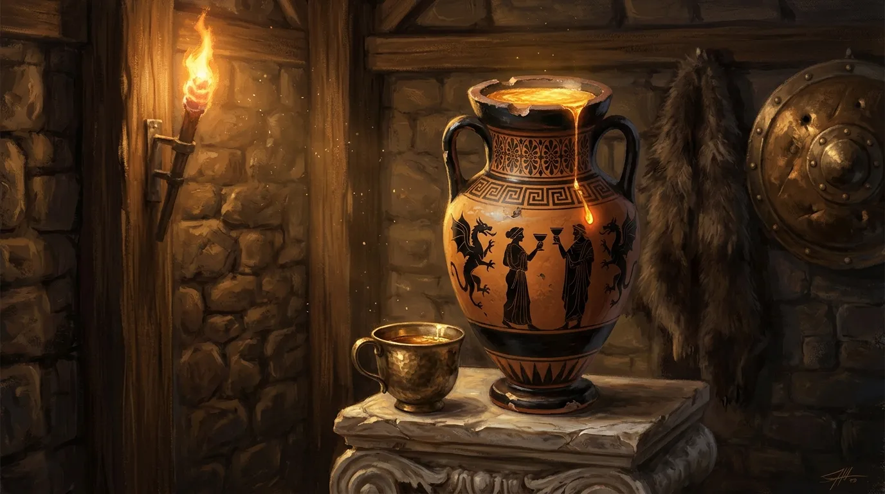

[Prompt](../assets/items/amfora_zakrotha.txt)

_Amfora z Ambrozją odebrana [[Zakroth|Zakrothowi]], jeden z trzech przedmiotów potrzebnych do rytuału [[Magia Thylei#Theogenesis (Apoteoza)|Teogenezy]]; przechowuje ją [[Astra]]._

_Cudowny przedmiot, legendarny (wymaga dostrojenia)_

## Opis
Malowana amfora ze Złotego Wieku Thylei, w której zbiera się gęsty, złocisty nektar o miodowym aromacie: Ambrozja, zwana też Nektarem Bogów. Pełną boskość daje dopiero dokończony rytuał Teogenezy. Według [[Królowa Helena|Królowej Heleny]] dawała [[Zakroth|Zakrothowi]] nadzwyczajną charyzmę przy werbowaniu bojowników.

Teogeneza wymaga jej razem z [[Kaduceusz Damona|Kaduceuszem Damona]] i [[Ogień Prometejski|Ogniem Prometejskim]].

## Właściwości
**Boska Prezencja.** Gdy jesteś dostrojony do amfory, twoja Charyzma wzrasta o 2 (najwyżej do 24), masz ułatwienie w testach Charyzmy (Perswazja), a niemagiczne próby wykrycia twoich kłamstw zawodzą.

**Krew Nieśmiertelnych.** Gdy jesteś dostrojony do amfory, przestajesz się starzeć i nie możesz umrzeć ze starości. Masz odporność na obrażenia od trucizny i jesteś niewrażliwy na stan zatrucia.

**Nektar Bogów.** Amfora ma 6 ładunków (porcji) i codziennie o świcie odzyskuje wszystkie zużyte. Trzymając ją, możesz zużywać ładunki na poniższe efekty (ST 18 albo ST twoich czarów, zależnie od tego, które jest wyższe):

- **Rozkaz Nektaru (1 ładunek, akcja dodatkowa).** Rzucasz *command* na 2. poziomie (najwyżej dwa cele).
- **Złoty Toast (1 ładunek, akcja dodatkowa).** Pijesz porcję albo podajesz ją chętnej istocie w zasięgu dotyku. Do końca swojego następnego krótkiego odpoczynku istota ma k10, który może dodać do jednego testu, rzutu ataku albo rzutu obronnego, oraz ułatwienie w pierwszym rzucie obronnym przeciw zauroczeniu albo przestrachowi.
- **Słowo Przekonania (1 ładunek, akcja).** Rzucasz *suggestion*. Jeśli cel nie jest wrogi i rozmawiał wcześniej z tobą, ma utrudnienie w rzucie obronnym.
- **Biesiada Bogów (3 ładunki, 10 minut albo krótki odpoczynek).** Rozlewasz nektar do pucharów dla najwyżej sześciu istot i rzucasz *heroes' feast* bez komponentów materialnych. Przez 24 godziny każda z nich ma też ułatwienie w pierwszym teście Charyzmy (Perswazja) wobec każdej nowo poznanej istoty.

## Historia
W [[Sesja 85 - Cienie nad Arezją]] [[Królowa Helena|Helena]] po chwili wahania przyznała [[Bohaterowie Przepowiedni|Bohaterom Przepowiedni]], że Zakroth ma taki przedmiot. Przyciśnięta pytaniami [[Arevon Elorrenthi|Arevona]] i [[Felicjan Janus Twardowski|Felicjana]] wyjawiła, że [[Narsus]] doznał objawienia, a amfora jest jednym z elementów potrzebnych do zaczerpnięcia mocy z pustych boskich domen.

W [[Sesja 86 - Trzy Klucze Teogenezy]] Narsus w [[Komnata Piękna|Komnacie Piękna]] wymienił Ambrozję jako drugi składnik Teogenezy, wskazany mu we śnie przez [[Balmytria|Balmytrię]]. [[Felicjan Janus Twardowski|Felicjan]] zaproponował, że wejdzie do obozu minotaura z planu eterycznego i podmieni Ambrozję, ale drużyna postanowiła najpierw porozmawiać z Zakrothem i ruszyła do [[Fort Zakrotha|Fortu Zakrotha]] w [[Bór Thrake|Borze Thrake]], którego położenie wskazał jej zdominowany satyr [[Tityros]].

W [[Sesja 87 - Upadek Zakrotha]] amfora stała w komnacie Zakrotha na najwyższym piętrze [[Fort Zakrotha|Fortu Zakrotha]] i świeciła. W czasie walki Felicjan przeteleportował się do niej i ją porwał, a [[Kairos]] wyniósł go z nią na grzbiecie. Zakroth ścigał go i rozkazywał oddać naczynie, lecz czarodziej oparł się jego woli. Felicjan zajrzał do środka: na dnie została tylko odrobina gęstego, złocistego płynu, za mało, by cokolwiek zdziałała.

W [[Sesja 88 - Krwawe Schody Fortu]] po walce na schodach [[Fort Zakrotha|Fortu Zakrotha]] amfora była jedynym obok miecza Zakrotha przedmiotem, który lśnił magią. Na [[Wyspa Yonder|Wyspie Yonder]] [[Felicjan Janus Twardowski|Felicjan]] rozpoznał jej moce. Nie zgodził się oddać jej [[Orestes|Orestesowi]] i namawiał [[Versir|Versira]], by sam się z nią związał, lecz paladyn uznał to za krok za daleko i powierzył ją swojej partnerce Astrze, która się z nią związała. Versir zastrzegł, że to rozwiązanie tymczasowe.
