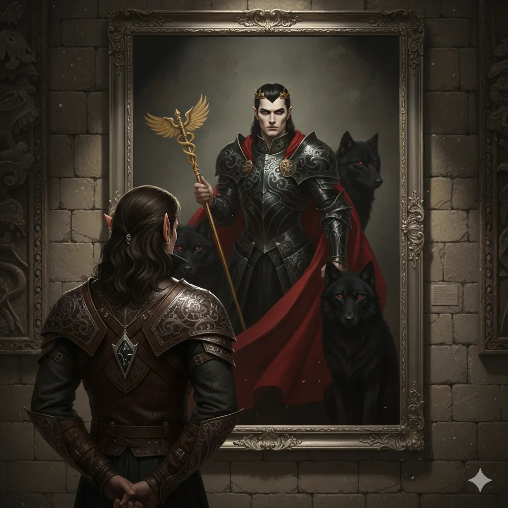

_Zaczarowany obraz przedstawiający pierwszego króla Arezji; w istocie filakterium z uwięzioną esencją potężnego nieumarłego. Od [[Sesja 63 - Werdykt Arezji]] należy do drużyny; ukryty przez [[Felicjan Janus Twardowski|Felicjana]] na [[Wyspa Yonder|Wyspie Yonder]]._

## Opis
Dzieło emanuje magią transmutacji i nekromancji. Przedstawia [[Karpathos|Karpathosa, Wilczego Lorda]], pierwszego króla [[Arezja|Arezji]]. Płótno jest tak mistrzowskie, że zdaje się żyć.

## Właściwości
W [[Sesja 62 - Arezyjska Dyplomacja]] krążyły plotki, że w obrazie uwięziona jest dusza samego króla. W [[Sesja 63 - Werdykt Arezji]] [[Felicjan Janus Twardowski|Felicjan]] zaklęciem identyfikacji odkrył, że obraz jest w rzeczywistości **filakterium**, w którym uwięziona jest esencja potężnego nieumarłego, prawdopodobnie króla-założyciela.

## Historia
W [[Sesja 62 - Arezyjska Dyplomacja]] drużyna zobaczyła obraz w [[Galeria Sztuki|Galerii Sztuki]] w Arezji. Podobno ktoś z Mytros zaoferował za niego 30 tysięcy sztuk złota.

W [[Sesja 63 - Werdykt Arezji]] [[Felicjan Janus Twardowski|Felicjan]] odkrył, że portret jest filakterium, a drużyna kupiła go od kustosza [[Halius|Haliusa]] za 50 000 sztuk złota. Obraz dostarczono nocą małą łodzią na pokład [[Ultros|Ultrosa]].

Po wojnie wisiał w kajucie kapitańskiej [[Ultros|Ultrosa]], zamienionego w bar. W [[Sesja 85 - Cienie nad Arezją]] czterech napastników próbowało włamać się do tej kajuty. [[Felicjan Janus Twardowski|Felicjan]] powiązał włamanie z poszukiwaniem artefaktów przez [[Arezja|Arezję]] i zaklęciem *Sequester*, kosztującym pięć tysięcy sztuk złota, uczynił obraz niewidzialnym i niewykrywalnym dla magii wieszczącej. Zabrał go na [[Wyspa Yonder|Wyspę Yonder]] i schował tam, zabezpieczając hasłem.

W [[Sesja 86 - Trzy Klucze Teogenezy]] [[Felicjan Janus Twardowski|Felicjan]] zapytał [[Królowa Helena|Królową Helenę]], czy portret ma związek z [[Kurhany Karpathosa|kurhanami Karpathosa]]. Królowa odparła, że obraz sprzedano z arezyjskiej [[Galeria Sztuki|galerii]] nielegalnie, a opowieści o zaklętej w nim duszy Wilczego Lorda traktowano w Arezji jako legendę. Gdy Felicjan zapytał, czy jakaś grupa mogłaby próbować wykraść portret, Helena spojrzała na niego podejrzliwie, stwierdziła, że powinna była się domyślić, kto był tajemniczym kupcem obrazu, i zapowiedziała, że porozmawia z pewnymi osobami. Bohaterowie zauważyli między sobą, że portret przez piętnaście lat wisiał zamknięty na klucz w kajucie kapitańskiej [[Ultros|Ultrosa]], ale wiedziała o nim praktycznie cała stara załoga statku.
