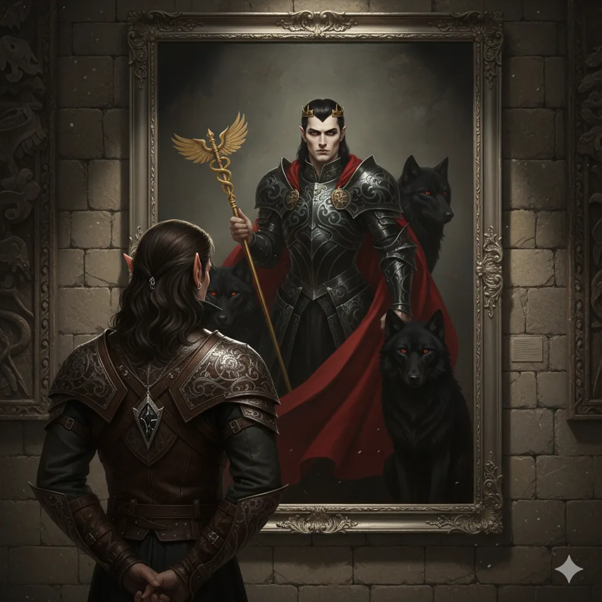

_Zaczarowany obraz przedstawiający pierwszego króla Arezji; w istocie filakterium z uwięzioną esencją potężnego nieumarłego. Od [[Sesja 63 - Werdykt Arezji]] należy do drużyny._

## Opis
Dzieło emanuje magią transmutacji i nekromancji. Przedstawia [[Karpathos|Karpathosa, Wilczego Lorda]], pierwszego króla [[Arezja|Arezji]]. Płótno jest tak mistrzowskie, że zdaje się żyć. <!-- UNSOURCED -->

## Właściwości
W [[Sesja 62 - Arezyjska Dyplomacja]] krążyły plotki, że w obrazie uwięziona jest dusza samego króla. W [[Sesja 63 - Werdykt Arezji]] [[Felicjan Janus Twardowski|Felicjan]] zaklęciem identyfikacji odkrył, że obraz jest w rzeczywistości **filakterium**, w którym uwięziona jest esencja potężnego nieumarłego, prawdopodobnie króla-założyciela.

## Historia
W [[Sesja 62 - Arezyjska Dyplomacja]] drużyna zobaczyła obraz w [[Galeria Sztuki|Galerii Sztuki]] w Arezji. Podobno ktoś z Mytros zaoferował za niego 30 tysięcy sztuk złota.

W [[Sesja 63 - Werdykt Arezji]] [[Felicjan Janus Twardowski|Felicjan]] odkrył, że portret jest filakterium, a drużyna kupiła go od kustosza [[Halius|Haliusa]] za 50 000 sztuk złota. Obraz dostarczono nocą małą łodzią na pokład [[Ultros|Ultrosa]].
