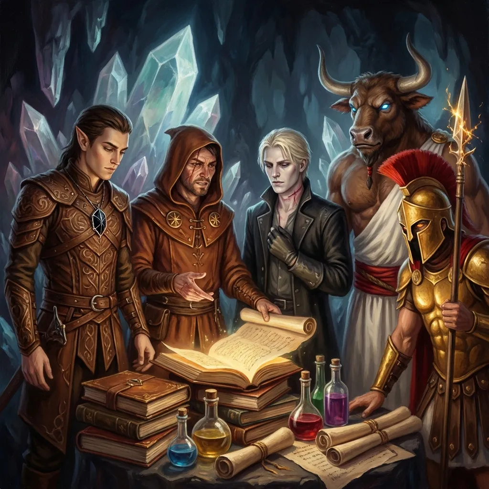

_Skarb, Legendarny_

## Opis
Legendarny skarb zgromadzony przez Smoczych Lordów z Pierwszej Wojny, ukryty w skarbcu [[Lustrzane Więzienie|Lustrzanego Więzienia]] na [[Morze Otchłani|Morzu Otchłani]], w dawnym leżu [[Kraken|Krakena]]. Strzeżony przez mosiężnego smoka [[Hezzebal]]a. Od [[Sesja 67 - Zguba Estora]] należy do załogi [[Ultros|Ultrosa]].

## Zawartość

### Magiczne Przedmioty
*   **Cloak of Protection** (otrzymał [[Orion Xul|Orion]]) <!-- UNSOURCED -->
*   **Wand of Polymorph** (otrzymał [[Felicjan Janus Twardowski|Felicjan]]) <!-- UNSOURCED -->
*   **Spellguard Shield** (otrzymał [[Orion Xul|Orion]]) <!-- UNSOURCED -->
*   **Oathbow (Longbow)** (otrzymał [[Arevon Elorrenthi|Arevon]]) <!-- UNSOURCED -->
*   **Tome of Understanding** (otrzymał [[Arevon Elorrenthi|Arevon]]) <!-- UNSOURCED -->
*   **Manual of Gainful Exercise** (otrzymał [[Orestes]]) <!-- UNSOURCED -->
*   **[[Xiphos of Slaughter]]** (otrzymał [[Versir]])
*   2x **Potion of Supreme Healing**
*   **Potion of Cloud Giant Strength**

### Zwoje Czarów (otrzymał [[Felicjan Janus Twardowski|Felicjan]])
*   Level 8: **Antimagic Field** <!-- UNSOURCED -->
*   Level 7: **Delayed Blast Fireball** <!-- UNSOURCED -->
*   Level 7: **Reverse Gravity** <!-- UNSOURCED -->
*   Level 6: **Arcane Gate** <!-- UNSOURCED -->
*   Level 6: **Chain Lightning** <!-- UNSOURCED -->
*   Level 5: **Animate Objects** <!-- UNSOURCED -->

### Bogactwa i Materiały
*   3x **Adamantine Ingot**
*   3x **Mithral Ingot**
*   1x **Orb of Star Metal** <!-- UNSOURCED -->
*   10,000 gp w kamieniach szlachetnych
*   2,000 pp
*   10,000 gp

## Historia
Skarb został ukryty 500 lat temu. <!-- UNSOURCED -->

W [[Sesja 66 - Przebudzenie Bestii i Cienie Otchłani]] duch [[Estor Arkelander|Estora]] ujawnił, że w dawnym leżu Krakena spoczywają szczątki [[Gregor Huorath|Gregora]] i Hezzebala wraz ze skarbami Smoczych Lordów.

W [[Sesja 67 - Zguba Estora]] załoga [[Ultros|Ultrosa]] pokonała Hezzebala i [[Estor Arkelander|Estora]] w skarbcu Lustrzanego Więzienia i zdobyła skarb: góry złota, platyny i klejnotów, rzadkie metale, księgi wiedzy, zwoje oraz legendarny rynsztunek, w tym [[Xiphos of Slaughter]], który trafił do [[Versir|Versira]].
