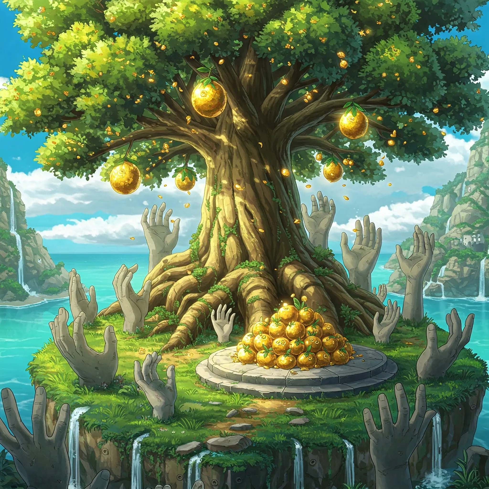

_Magiczne owoce z Drzewa Serca_

## Opis
Owoce przypominające jabłka, ale lśniące złotem. <!-- UNSOURCED -->

Rosną na [[Drzewo Serca|Drzewie Serca]] na [[Wyspa Złotego Serca|Wyspie Złotego Serca]].

## Właściwości
Mają potężne właściwości lecznicze. Mówi się, że potrafią uleczyć każdą chorobę. <!-- UNSOURCED -->

Sternik małego stateczku, [[Laios]], prosił drużynę o pomoc w zdobyciu owoców, które miały uzdrowić jego chorą żonę.

## Historia
Według wizji początków [[Kontynent Thylea|Thylei]] z [[Sesja 39 - Tajemnice Wyspy Złotego Serca]] strażnik kontynentu [[Kentimane]], skuszony pięknem siedmiu owoców Drzewa Serca, zerwał je i jego pięćdziesiąt głów rozkoszowało się ich smakiem. Nasiona, które po nich zostały, dały początek Tytanom, dzieciom [[Thylea|Thylei]] i Kentimane'a.

W [[Sesja 39 - Tajemnice Wyspy Złotego Serca]] bohaterowie zerwali złote owoce, by pomóc Laiosowi i jego żonie.

W [[Sesja 83 - Zmierzch Ery Tytanów]] [[Versir]] wyciągnął złoty owoc, gdy przemawiał do Kentimane'a w czasie bitwy o [[Mytros]].
