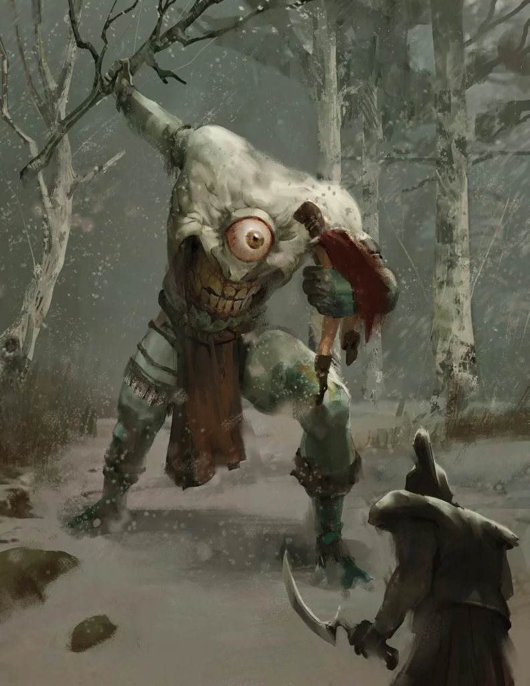

_Monstrualne istoty, góry drgającego mięśnia, które chwytają przeciwników w żelazne uściski._

## Opis
Blemysi to monstrualne, opancerzone istoty bez głów, o niezwykłej sile. W walce chwytają bohaterów w żelaznych uściskach i ciskają nimi jak szmacianymi lalkami.

W transkrypcie [[Sesja 72 - Śniadanie u Tytana Bochenek Przeznaczenia]] Mistrz Gry nazwał blemysami także dwóch jednookich pracowników kuźni w [[Praxys]], a strażnik kuźni, z którym rozmawiali bohaterowie, to w recapie cyklop [[Garzoon]].

## Zachowanie
Blemysi pełnią rolę ochrony i strażników. [[Talieus]] przywołał ich, by „zajęli się” bohaterami, a w [[Praxys]] pilnowali [[Królowa Myrmeków|Królowej Myrmeków]].

## Historia
- [[Sesja 23 - Nowe Przymierze]]: w trakcie podróży bohaterowie spotkali dziwnego cyklopa, nazwanego Blemys.
- [[Sesja 59 - Koniec Imprezy]]: w latającej fortecy [[Talieus|Talieusa]] dwa Blemysy wyłoniły się z cieni na jego rozkaz jako ochrona. Rzucały bohaterami (Orion posłużył jako pocisk wymierzony w Arevona, a Orestes został zderzony z Felicjanem), ale drużyna je pokonała.
- [[Sesja 71 - Infiltracja Praxys]]: w Praxys bohaterowie spotkali dwóch opancerzonych, bezgłowych strażników z rasy Blemysów, którzy pilnowali spętanej [[Królowa Myrmeków|Królowej Myrmeków]]. [[Orestes]] przytrzymał jednego z nich, a drużyna skutecznie powaliła atakujących w amoku Blemysów.
- [[Sesja 72 - Śniadanie u Tytana Bochenek Przeznaczenia]]: w kuźni Praxys bohaterowie zastali dwóch jednookich blemysów obsługujących dźwignie maszynerii.
